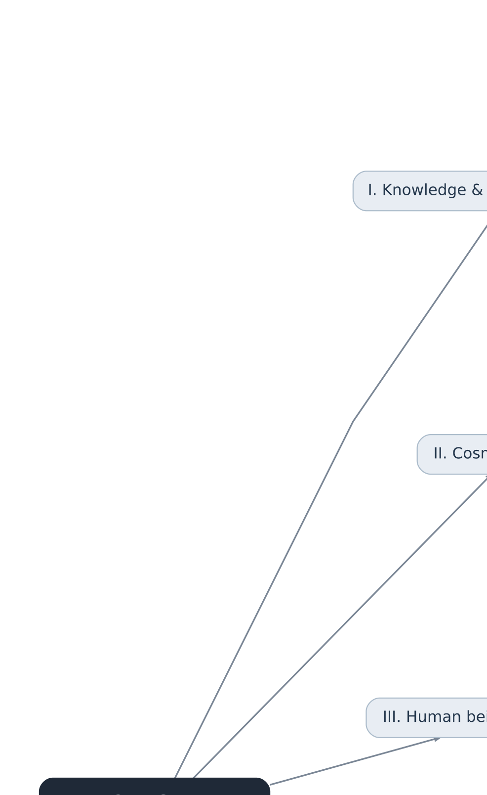

# Rudolf Steiner Atlas

A source-grounded, evolving thematic atlas of the **teachings of Rudolf Steiner**, designed to be navigable from broad domains through individual concepts to exact passages in his writings and recorded lectures.

> **Status:** Foundation / taxonomy v1.0 (1 November 2026). This classification is a research-created working taxonomy, not a list of headings chosen by Steiner. GA volume references are often **research leads**, not verified passage-level citations.

## Current scope

- Six major regions, 26 thematic domains, 150 subdomains, 785 concepts and 39 further-detail entries (first-pass totals).
- 30 conceptual crosslinks maintained independently of the primary knowledge tree.
- Versioned Markdown, JSON and OPML taxonomy and Mermaid/SVG mind maps.
- Primary-source editorial method, research roadmap and validation tooling.

### Six top-level regions

1. Knowledge, Method, and Spiritual Development (domains 01–04)
2. Cosmos, Spiritual Realities, and Destiny (05–08)
3. The Human Being, Mind, and Biography (09–12)
4. Christ, Religion, and Civilizations (13–16)
5. Science, Healing, Education, and Society (17–21)
6. Art, Architecture, Ritual, and Anthroposophical Life (22–26)

## Browse the project

| File | Use |
| --- | --- |
| [Full taxonomy](taxonomy/taxonomy-v1.md) | Read the complete thematic outline |
| [JSON taxonomy](taxonomy/taxonomy-v1.json) | Canonical structured data and crosslinks |
| [OPML taxonomy](taxonomy/taxonomy-v1.opml) | Mind-mapping outline interchange |
| [Editable Mermaid mind map](assets/mindmaps/overview.mmd) | Diagram source |
| [SVG mind map](assets/mindmaps/overview.svg) | Scalable overview |
| [Source method](docs/SOURCE_METHOD.md) | Evidence and editorial standards |
| [Roadmap](docs/ROADMAP.md) | Research and HTML development phases |
| [Content model](docs/CONTENT_MODEL.md) | Node IDs and source-aware records |
| [Workflow](docs/WORKFLOW.md) | GitHub development process |

## Sources and editorial scope

Substantive teaching entries are based only on **Steiner's own books, writings, recorded lectures and directly attributable artistic work**. Bibliographic catalogues are permitted to identify primary materials; later anthroposophical authors are not substituted for Steiner's teachings.

GA numbers alone **do not verify** a claim's presence in an exact lecture. Preserve differences between authored books, recorded lectures and editorial compilations, and record translation and attribution uncertainties. Steiner's spiritual-scientific, historical and empirical claims must be identified as his positions rather than presented as independently established facts. See [SOURCE_METHOD.md](docs/SOURCE_METHOD.md).

Principal archives: [Rudolf Steiner Archive](https://rsarchive.org/), [GA volumes](https://rsarchive.org/Volumes.html), [official Complete Works catalogue](https://www.rudolf-steiner.com/en/edition-englisch/complete-works/).

## Quality control and future work

Run `python tools/validate_taxonomy.py` to check stable IDs and crosslink integrity. The next major research milestone is a **GA-by-GA primary-source corpus audit**, followed by passage-level concept records and an interactive HTML atlas.

## Rights

The taxonomy, notes and diagrams are an original working classification. Original Steiner texts and translations may carry separate copyright restrictions; do not copy substantial external text into the repo without assessing rights. This project has no general license at present.

## Companion architecture and prototype

**This is a conceptual index over the archives, not a second text archive.** RS Archive remains the destination for Steiner's writings and lectures; the Rudolf Steiner Archiv in Dornach provides the Complete Works bibliographic framework. The Atlas adds fine-grained classification, stable concept IDs, cross-domain routes, controlled term search and graded source references. [Read the architecture and non-duplication rules](docs/COMPLEMENTARY_ARCHITECTURE.md).

[Run the static atlas prototype](atlas/README.md): from the repository root run `python -m http.server 8000` and open `http://localhost:8000/atlas/`. It is committed but **not yet deployed** as a public website.

**Current research:** 1,006 nodes, eight editorial routes, 14 links back to RS Archive subject lists, 41 alternative search phrases, 19 earlier located gateway records, three comparison models, and automated integrity checks. [See source coverage and gaps](docs/SOURCE_COVERAGE_2026-11-01.md).

## Passage-linked knowledge graph · iteration 2026-11-02

The [knowledge graph explorer](atlas/graph.html) is a second, evidence-first navigation mode. It currently contains **116 typed relationships from 27 Steiner primary-source pages**, including **51 cross-domain connections**, and distinguishes paraphrases of selected checked passages from source-comparison judgments. It links directly to the original archive without rehosting source material.

- [Graph methodology, evidence levels and source URLs](docs/KNOWLEDGE_GRAPH_METHOD.md)
- [Reproducible graph coverage audit](docs/KNOWLEDGE_GRAPH_COVERAGE.md)
- [Original graph dataset](research/knowledge-graph-v1.json)
- [Reconciliation of 30 earlier hypothetical crosslinks](research/legacy-crosslink-audit.json) — 4 directly source-matched, 1 supported only at a narrower descendant level, 25 with no matching passage-level evidence
- [Work completed and further limitations](docs/ITERATION_2026-11-02.md)

Run locally with `python -m http.server 8000` and open `http://localhost:8000/atlas/` (concepts), `/atlas/graph.html` (evidence network) or `/atlas/sources.html` (source guide). The site has not been publicly deployed.

## Iteration 4 — stronger research breadth and reproducibility

- Graph relationships now reach all **26 thematic domains** (not all individual concepts).
- [Find original source works](atlas/sources.html) by GA, date, title, domain and source type; links lead outward to the archive.
- All **974 named taxonomy entries** are checked against JSON, Markdown and OPML so stable IDs remain consistent.
- [Desktop/mobile Chromium smoke tests](tests/atlas-browser-smoke.mjs) and [GitHub Actions](.github/workflows/browser-smoke.yml) cover concept search, graph filtering and source discovery.
- [Iteration report](docs/ITERATION_2026-11-02_EXPANSION.md) and [current domain coverage](docs/KNOWLEDGE_GRAPH_COVERAGE.md) describe completed work and open gaps.
